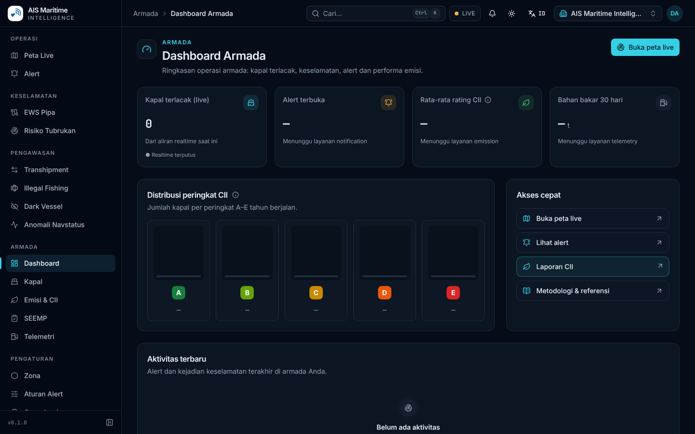
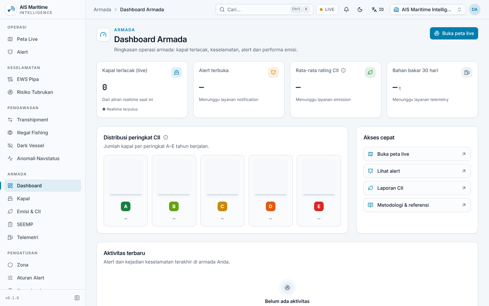
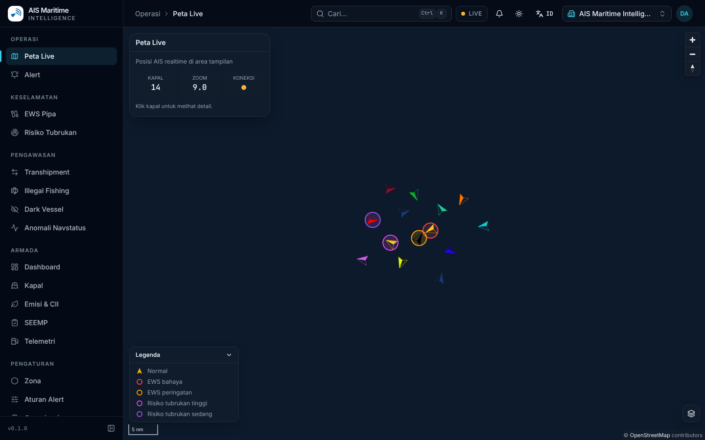

# ais-its-web — AIS Maritime Intelligence

Web application of **AIS Maritime Intelligence** v2 (formerly `ais-its-cii-seemp-fe`; the MVP
history stays on branch `mvp-version`, tag `mvp-final`). A dark-first maritime operations
console: live vessel tracking, pipeline EWS, collision risk, illegal transhipment / fishing,
dark vessels, navstatus anomalies, zones, alerts, CII/SEEMP emissions, telemetry and
administration — built so that a new feature is **one folder** under `src/features/`.

Normative specification: `docs/PLATFORM_SPEC.md` of the central repository (§8 identity,
§9 realtime, §12 gateway, §13.1 auth, §14 web, §17 methodology).

| Login                                | Dashboard (dark)                                       | Dashboard (light)                                        | Live map                              |
| ------------------------------------ | ------------------------------------------------------ | -------------------------------------------------------- | ------------------------------------- |
|  |  |  |  |

## Stack

React 19 · Vite 8 (Rolldown) · TypeScript ~6.0 (strict) · Tailwind CSS 4 · shadcn/ui-style
components on Radix (`radix-ui`) · TanStack Query 5 (+ devtools in dev) · TanStack Table 8 ·
react-router 7 (data router) · Zustand 5 · react-hook-form + zod 4 · i18next (id default, en) ·
date-fns 4 · lucide-react · recharts 3 · MapLibre GL 6 + deck.gl 9 (`@deck.gl/mapbox`) ·
terra-draw · socket.io-client 4.8 · KaTeX · orval 8 · vitest 4 + Testing Library + MSW 2 ·
Playwright · ESLint 9 flat config · Prettier · husky + commitlint ·
`@darmawanweb/ais-its-contracts` (roles/permissions, realtime protocol, domain labels, problem
details, methodology catalog).

## Quick start

```bash
# once: map the @darmawanweb scope in ~/.npmrc (never in this repository)
#   @darmawanweb:registry=https://npm.pkg.github.com
#   //npm.pkg.github.com/:_authToken=${GITHUB_TOKEN}
pnpm install
cp .env.example .env.local          # optional: map style, proxy target…
pnpm dev                            # http://localhost:5173 (proxies /api, /ws, /tiles, /.well-known → :8000)
```

The dev server proxies to the Traefik gateway (`http://localhost:8000`, `pnpm infra:up` +
services in the central repository). Through the gateway the app is also served at
`http://localhost:8000`. Without a backend, `pnpm e2e:mock` starts the mock gateway used by
the e2e tests (`VITE_DEV_PROXY_TARGET=http://localhost:8787 pnpm dev`; accounts
`admin@ais-its.local` / `ChangeMe123!` and `manager@pelni.test` / `Kapal12345`).

## Scripts

| Script                                                               | What it does                                                                    |
| -------------------------------------------------------------------- | ------------------------------------------------------------------------------- |
| `pnpm dev` / `pnpm preview`                                          | Vite dev server (5173) / preview of the production build (4173)                 |
| `pnpm build`                                                         | `tsc -b` + production bundle in `dist/` (hidden source maps)                    |
| `pnpm lint` / `pnpm typecheck` / `pnpm format` / `pnpm format:check` | ESLint (0 warnings), TypeScript project references, Prettier                    |
| `pnpm test` / `pnpm test:watch` / `pnpm test:coverage`               | vitest + jsdom + MSW                                                            |
| `pnpm test:e2e`                                                      | Playwright smoke tests, headless (builds, starts `vite preview` + mock gateway) |
| `pnpm screenshots`                                                   | refreshes `docs/screenshots/*.png`                                              |
| `pnpm api:generate`                                                  | orval clients for every service with an `openapi.json`; prints the skipped ones |
| `pnpm methodology:sync`                                              | copies `docs/references/{methods,references}.json` into `public/methodology/`   |
| `pnpm e2e:mock`                                                      | mock gateway on :8787                                                           |

## Environment

Every variable is listed in [`.env.example`](.env.example). Build time: Vite reads `VITE_*`
from `.env*`. Run time (containers): the same names are written to `/config.js`
(`window.__AIS_CONFIG__`) at start, so one image runs everywhere; runtime values win
(`src/shared/config/env.ts`, validated with zod).

| Variable                                                            | Default                        | Purpose                                             |
| ------------------------------------------------------------------- | ------------------------------ | --------------------------------------------------- |
| `VITE_API_BASE_URL`                                                 | same origin                    | API base (`/api/v2/...` paths)                      |
| `VITE_REALTIME_URL` / `VITE_REALTIME_PATH`                          | same origin / `/ws`            | socket.io server                                    |
| `VITE_TILES_BASE_URL`                                               | `/tiles`                       | Martin tiles; MapLibre sends the bearer token there |
| `VITE_MAP_STYLE_URL` (+ `_LIGHT_URL`, `VITE_MAP_STYLE_ATTRIBUTION`) | empty                          | dark vector basemap; empty = OSM raster fallback    |
| `VITE_MAP_OSM_TILES_URL` / `VITE_MAP_SATELLITE_TILES_URL`           | OSM / Esri World Imagery       | raster basemaps                                     |
| `VITE_MAP_DEFAULT_BASEMAP`                                          | vector if configured, else osm | `vector` \| `osm` \| `satellite`                    |
| `VITE_DEFAULT_LOCALE`                                               | `id`                           | UI language (`id` \| `en`)                          |
| `VITE_APP_ENV` / `VITE_APP_VERSION`                                 | mode / 0.1.0                   | labels in the sidebar footer                        |
| `VITE_QUERY_DEVTOOLS`                                               | `true` (dev only)              | TanStack Query devtools                             |
| `VITE_DEV_PROXY_TARGET`                                             | `http://localhost:8000`        | dev/preview proxy target                            |

## Architecture

```
src/
  main.tsx                 fonts, styles, i18n; initSession() + bootstrapSession() + realtime.start()
  app/                     the shell (foundation-owned)
    features.ts            discovers src/features/*/routes.tsx (import.meta.glob) + registers i18n
    router.tsx             route tree: public feature routes | RequireAuth → AppShell → feature routes | 404
    navigation.ts          sidebar sections/items, commands and slots from the feature modules
    providers.tsx          QueryClient, tooltips, theme sync, toasts, devtools, cache guard (logout/org switch)
    shell/                 AppShell, Sidebar, Topbar, CommandPalette, OrgSwitcher, UserMenu, alerts bell placeholder
    pages/                 404 and error boundaries
  features/<id>/           feature modules (routes.tsx, i18n/, pages/, components/, api/, hooks/)
  shared/                  everything features use (foundation-owned)
    feature/               FeatureModule contract: defineFeature, lazyPage, NavItem, AppRouteHandle
    auth/                  session store, auth API, single-flight refresh, guards, useSession/usePermission
    api/                   axios instance, ApiProblem, queryClient, query keys, orval mutator, generated/<service>/
    realtime/              socket.io manager, normalized vessel store, realtime hooks
    map/                   MapView, layer registry, viewport hook, vessel icon atlas + layer, legends, layouts
    ui/                    shadcn/ui-style primitives
    domain-ui/             domain components (badges, values, DataTable, MethodInfo, PageHeader…)
    methodology/           catalog loader + KaTeX Formula
    i18n/ config/ theme/ stores/ hooks/ lib/
  styles/globals.css       design tokens (CSS variables, Tailwind @theme)
  test/                    vitest setup, MSW handlers, render helpers, token factory
e2e/                       Playwright smoke + screenshot specs, mock gateway
docker/                    nginx config, runtime config script
```

**Adding a feature** = a folder `src/features/<id>/` with a `routes.tsx` exporting
`feature = defineFeature({ id, i18n, routes, nav })` — no shared file changes. The complete
rules are in **[docs/FEATURE_GUIDE.md](docs/FEATURE_GUIDE.md)**.

### Authentication and session (spec §8, §13.1)

- Login (e-mail/password, then a 6-digit TOTP step when MFA is on), forgot password,
  reset password and invite acceptance (token from `#token=` or `?token=`, stripped from the URL).
  Problem details are mapped to messages; 429 shows a Retry-After countdown.
- The access token lives **in memory only** (Zustand vanilla store); the refresh token is the
  HttpOnly `aisits_rt` cookie. On page load `POST /api/v2/auth/refresh` restores the session.
- Refresh is single-flight (one request for concurrent 401s), serialized across tabs with the
  Web Locks API (rotating refresh tokens + reuse detection), shared with other tabs through a
  BroadcastChannel, and scheduled one minute before expiry. A 401 is retried once with the new
  token; a rejected refresh ends the session ("session expired" notice on the login page).
- `useSession()` exposes the decoded claims (`sub`, `org`, `roles`, `email`, `name`);
  `usePermission(perm)` uses contracts `ROLE_PERMISSIONS` (super_admin: everything);
  `useCanAccessOrg(orgId)` applies the tenant rule; `RequireAuth`, `RequirePermission`, `Can`.
- Organization switch: `POST /api/v2/auth/switch-org` → new token, query cache reset, socket
  reconnected (rooms are joined at handshake).

### API layer

One axios instance (`src/shared/api/http.ts`, same-origin base URL): bearer token,
`X-Request-Id`, refresh-on-401, and every error mapped to `ApiProblem` (RFC 9457 fields +
`retryAfterSeconds`, `fieldErrors()`). TanStack Query defaults: `staleTime` 30 s, no retry for
4xx, two retries for network/5xx, cache cleared on logout and reset on org switch.
orval (`orval.config.ts`, `pnpm api:generate`) generates per service TanStack Query hooks +
plain TS types into `src/shared/api/generated/<service>/` from
`../../services/<service>/openapi.json` (override with `OPENAPI_SERVICES_DIR`), using the shared
mutator; services without a document are skipped and reported (`generated/manifest.json`).

### Realtime (spec §9)

`src/shared/realtime`: one socket.io connection per tab on `/ws` while signed in; the handshake
token is read on every (re)connection and `connect_error UNAUTHORIZED` triggers a refresh and
reconnect. The viewport (`viewport:set`, zoom-6 tile rooms) and vessel subscriptions are
replayed after reconnects. Positions and safety states are merged into a normalized store
(Map by MMSI, out-of-order messages ignored, pruned after 30 min) read through throttled
snapshots. Hooks: `useRealtimeConnection`, `useViewportPositions`, `useVesselSnapshot`,
`useVesselLive`, `useAlertStream`, `useCiiUpdates`.

### Map

`<MapView>` = MapLibre GL + **`@deck.gl/mapbox` `MapboxOverlay` in overlaid mode**
(`interleaved: false`), chosen so deck.gl layers survive basemap switches; a layer registry
(`useDeckLayers`, `useMapLibreLayers`) lets features add layers without touching the map.
Basemaps: dark vector style (`VITE_MAP_STYLE_URL`), OpenStreetMap raster fallback (inverted in
the dark theme), Esri World Imagery; persisted per user. Vessel icons come from the legacy
ship-type PNGs packed into an atlas at runtime, rotated by heading/COG, with a ring for EWS
danger/warning and collision risk. Attributions are always visible (non-compact control);
`<DataAttribution provider="open-meteo" />` for weather values. Default view: Batam.

### Design system

Dark-first tokens in `src/styles/globals.css` (`--background`, `--surface`, `--elevated`,
`--border`, `--muted`, `--foreground`, `--primary` sea-cyan, `--success`, `--warning`,
`--danger`, `--info`, `--chart-1…8`, CII grades A `#15803d` B `#65a30d` C `#ca8a04` D `#ea580c`
E `#dc2626`), exposed as Tailwind colours (`bg-surface`, `text-primary`, `bg-grade-a`…).
Inter Variable for UI, JetBrains Mono Variable (tabular, slashed zero) for MMSI, coordinates
and figures — both self-hosted via @fontsource. Radius scale from `--radius`, 3 px focus rings,
`prefers-reduced-motion` respected. Theme (dark/light/system) and language toggles in the top
bar; `public/theme-init.js` applies the theme before the first paint.

### Methodology (spec §17)

`<MethodInfo methodId="…" />` shows a method's name, KaTeX formula, variables, constants and
sources with a link to `/methodology#<methodId>`. The catalog is read from
`@darmawanweb/ais-its-contracts/references` when it ships data, otherwise from
`public/methodology/*.json` (`pnpm methodology:sync`), otherwise a "source pending" state.

## Testing

- **Unit/component** (`pnpm test`): session (bootstrap, single-flight refresh, 401 retry,
  login/MFA/org switch/logout), token claims, permissions and guards, problem details mapping
  and retry policy, realtime store merge/prune, navigation, login/reset pages, methodology
  loader. Helpers in `src/test` (`renderApp`, `renderWithProviders`, MSW `server`, `makeAccessToken`).
- **E2E** (`pnpm test:e2e`): login (incl. wrong password), shell, sidebar navigation, live map
  with seeded vessels, command palette, session restore after reload (no token in storage),
  language switch, logout and permission gating — headless Chromium against the production
  build and `e2e/mock-server/server.mjs`.

## Docker

```bash
DOCKER_BUILDKIT=1 docker build --secret id=npmrc,src=$HOME/.npmrc -t ais-its-web .
docker run --rm -p 8080:8080 -e VITE_MAP_STYLE_URL=https://… ais-its-web
```

Multi-stage: `node:24-alpine` builds (pnpm via corepack, registry credentials only as the
BuildKit secret `npmrc`, optional `ca` secret), `nginx:1.29-alpine` serves as user `nginx`
on **8080** with SPA fallback, gzip, immutable caching for `/assets/*`, `no-cache` for
`index.html`/`config.js`, security headers + CSP, `/healthz`, and `/config.js` generated from
the environment at start (`docker/40-runtime-config.sh`). The gateway (stack mode) proxies `/`
to `web:8080`.

## CI/CD

`.github/workflows/ci.yml`: install (GitHub Packages scope via `actions/setup-node` +
`NODE_AUTH_TOKEN`), format check, lint, typecheck, unit tests, build; Playwright e2e; Docker
image (pushed to `ghcr.io/darmawanweb/ais-its-web` on `main`). `release.yml`: on tag `v*`
(must match `package.json`), versioned image. Dependabot for npm and actions. Husky runs
lint-staged on commit and commitlint (conventional commits) on the message.

## License

UNLICENSED — private. Use and modification are restricted to authorized users only.
