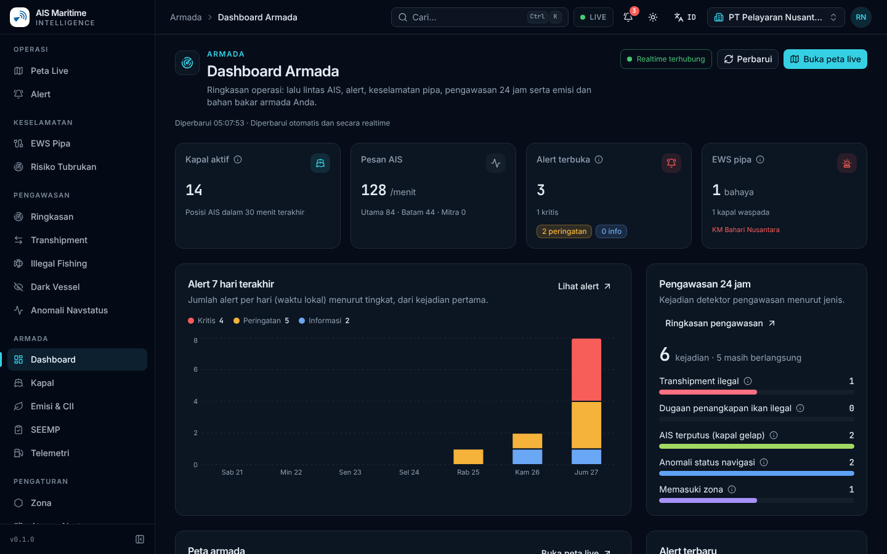
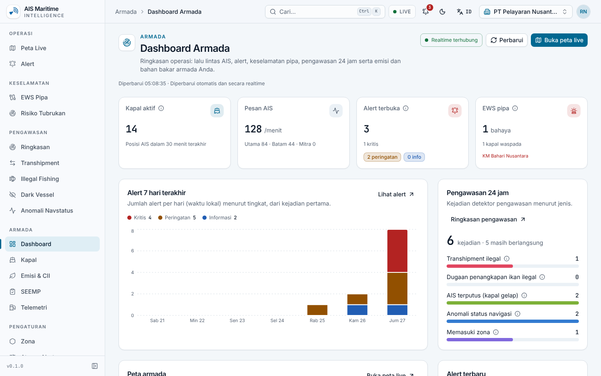
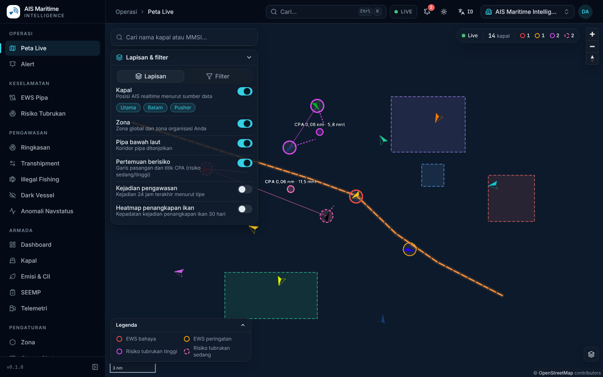
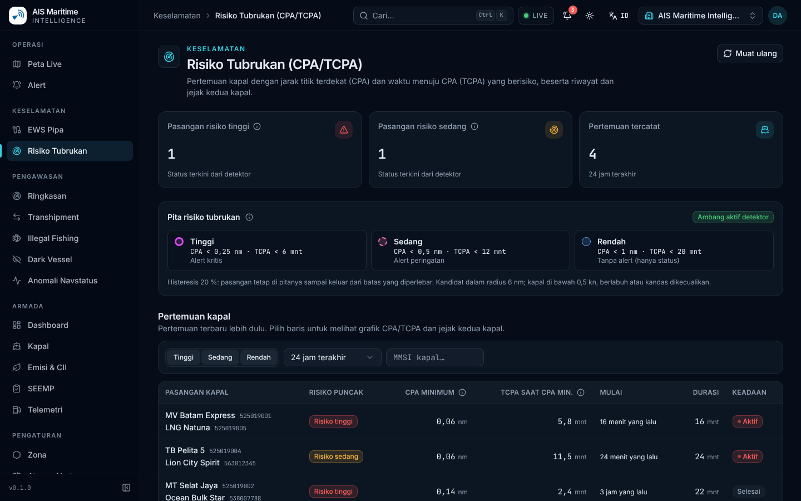

# ais-its-web — AIS Maritime Intelligence

Web application of **AIS Maritime Intelligence** v2 (formerly `ais-its-cii-seemp-fe`; the MVP
history stays on branch `mvp-version`, tag `mvp-final`). A dark-first maritime operations
console: live vessel tracking, pipeline EWS, collision risk, illegal transhipment / fishing,
dark vessels, navstatus anomalies, zones, alerts, CII/SEEMP emissions, telemetry and
administration — built so that a new feature is **one folder** under `src/features/`.

Normative specification: `docs/PLATFORM_SPEC.md` of the central repository (§8 identity,
§9 realtime, §12 gateway, §13.1 auth, §14 web, §17 methodology).

| Dashboard (dark)                                                | Dashboard (light)                                                 | Live map                                        | Collision risk                                                |
| --------------------------------------------------------------- | ----------------------------------------------------------------- | ----------------------------------------------- | ------------------------------------------------------------- |
|  |  |  |  |

Every page, in both themes and on a phone: **[docs/SCREENSHOTS.md](docs/SCREENSHOTS.md)**.

## Features

Sidebar sections as the UI shows them (Bahasa Indonesia by default, complete English). Every
route checks its permission (spec §8.4); actions a role cannot perform are not shown.
Endpoints are relative to `/api/v2` (gateway, spec §12); "realtime" is the socket.io stream of
spec §9.

| Section     | Page (route)                                                                                | What it does                                                                                                                                                                                                                                                                                         | Services                                                                                                                                                                                                                                                                                                  | Permission                                                                                  |
| ----------- | ------------------------------------------------------------------------------------------- | ---------------------------------------------------------------------------------------------------------------------------------------------------------------------------------------------------------------------------------------------------------------------------------------------------- | --------------------------------------------------------------------------------------------------------------------------------------------------------------------------------------------------------------------------------------------------------------------------------------------------------- | ------------------------------------------------------------------------------------------- |
| Operasi     | Live map (`/map`)                                                                           | deck.gl vessels (clusters, dots, rotated ship-type icons; tested with 10 000), safety rings, vessel panel with track playback, zones, pipelines, encounters, surveillance events, fishing heatmap                                                                                                    | ais-processor `/ais/latest`, `/ais/vessels/:mmsi/track`, `/ais/pairs/track`; realtime positions + safety states; safety `/safety/vessels/:mmsi`, `/safety/encounters`; geo `/zones/geojson` + Martin `/tiles`; surveillance `/events`, `/heatmap`; fleet `/vessels/by-mmsi/:mmsi`; notification `/alerts` | `ais:read`                                                                                  |
| Operasi     | Alerts (`/alerts`, top bar bell)                                                            | cursor-paged inbox, filters in the URL, detail drawer (method, mini map, timeline, deliveries), optimistic acknowledge/resolve, CSV, live rows and critical toasts                                                                                                                                   | notification `/alerts`, `/alerts/summary`, `/alerts/:id`, `/alerts/:id/occurrences`, `/alerts/export.csv`, `/alerts/:id/acknowledge`, `/alerts/:id/resolve`, `/notifications/deliveries`; realtime `alert:raised` / `alert:updated`                                                                       | `alert:read` (`alert:ack`, `alert_rule:write` for deliveries)                               |
| Keselamatan | Pipeline EWS (`/safety/ews`)                                                                | vessels near pipelines with distance and status, corridors map, event history, active thresholds                                                                                                                                                                                                     | safety `/safety/vessels`, `/safety/events`, `/safety/detectors`; geo pipeline zones                                                                                                                                                                                                                       | `safety:read`                                                                               |
| Keselamatan | Collision risk (`/safety/collision`)                                                        | encounters with peak risk and minimum CPA, CPA/TCPA charts, both tracks                                                                                                                                                                                                                              | safety `/safety/encounters[/:id]`, `/safety/vessels`; ais-processor `/ais/pairs/track`                                                                                                                                                                                                                    | `safety:read`                                                                               |
| Pengawasan  | Overview (`/surveillance`)                                                                  | events per type over time, severity/review breakdown, detectors and thresholds, transhipment candidate queue                                                                                                                                                                                         | surveillance `/surveillance/stats`, `/stats/series`, `/events`, `/detectors`, `/transhipments`                                                                                                                                                                                                            | `surveillance:read`                                                                         |
| Pengawasan  | Transhipment (`/surveillance/transhipment[/:eventId]`)                                      | events and legacy analysis results, pair replay, score card, review                                                                                                                                                                                                                                  | surveillance `/events?type=transhipment`, `/transhipments`, `PATCH /events/:id`; ais-processor `/ais/pairs/track`                                                                                                                                                                                         | `surveillance:read` (`surveillance:review`)                                                 |
| Pengawasan  | Fishing, dark vessels, navstatus anomalies (`/surveillance/{fishing,dark,anomaly}`)         | detections with maps (heatmap, harbour band, reappearance lines), historical violations, event sheet with review, CSV                                                                                                                                                                                | surveillance `/events`, `/heatmap`, `/fishing-violations`; geo zones                                                                                                                                                                                                                                      | `surveillance:read`                                                                         |
| Armada      | Dashboard (`/dashboard`, `/` redirects)                                                     | KPIs (active vessels, AIS rate, open alerts, EWS), 7-day alert and 6-hour AIS charts from the services' series, surveillance, CII grades and fleet fuel, live fleet map; each card hidden without its permission                                                                                     | ais-processor `/ais/stats`, `/ais/stats/series`; notification `/alerts/summary`, `/alerts/stats/series`, `/alerts`; safety `/safety/stats`, `/safety/vessels`; surveillance `/surveillance/stats`; emission `/cii/fleet/summary`, `/cii/fleet/fuel`                                                       | `vessel:read`                                                                               |
| Armada      | Vessels (`/vessels`, `/vessels/new`, `/vessels/:mmsi[/edit]`)                               | fleet list, create/edit with registry lookup, fuel formula check and photo, detail tabs (overview, live, CII, telemetry, alerts)                                                                                                                                                                     | fleet `/vessels`, `/vessels/by-mmsi/:mmsi`, reference data, `/registry`, photos; ais-processor `/ais/latest?mmsi=` (batch) and vessel latest; safety state; emission CII; telemetry status/summary/readings; notification alerts                                                                          | `vessel:read` (`vessel:write`)                                                              |
| Armada      | CII (`/cii`, `/cii/vessels/:mmsi`, `/cii/reduction-factors`)                                | fleet grades, vessel summary with A–E scale and projection, history with manual records, segments, DCS (CSV), reduction factors editor, recompute                                                                                                                                                    | emission `/cii/fleet/summary`, `/cii/vessels/:mmsi/{current,daily,annual,segments}`, annual-manual, `/emission/dcs`, `/reduction-factors`, recompute jobs; fleet identity                                                                                                                                 | `cii:read` (`vessel:write`, `reference:write`, super_admin)                                 |
| Armada      | SEEMP (`/seemp`, `/seemp/vessels/:mmsi`)                                                    | planning figures, measure catalog, recommendations, simulation, saved scenarios and comparison                                                                                                                                                                                                       | emission `/seemp/measures`, `/seemp/vessels/:mmsi/{recommendations,simulate}`, `/seemp/scenarios`; emission annual CII                                                                                                                                                                                    | `seemp:read` (`seemp:simulate`)                                                             |
| Armada      | Telemetry (`/telemetry`)                                                                    | readings explorer (range, resolution), stacked ME/AE chart, streamed CSV export, manual reading, the vessel's devices (read-only without `device:manage`), MQTT/HTTP instructions                                                                                                                    | telemetry `/telemetry/vessels`, `/telemetry/vessels/:mmsi/{readings,readings.csv,summary,status,devices}`, `POST /telemetry/readings`, `/telemetry/devices`                                                                                                                                               | `telemetry:read` (`telemetry:write`, `device:manage`)                                       |
| Pengaturan  | Zones (`/zones`, `/zones/new`, `/zones/:id`)                                                | registry with map, GeoJSON import/export, terra-draw editor with per-kind tools, buffer preview, ETag/If-Match conflicts                                                                                                                                                                             | geo `/zones`, `/zones/:id` (If-Match), `/zones/geojson`                                                                                                                                                                                                                                                   | `zone:read` (`zone:write`)                                                                  |
| Pengaturan  | Alert rules (`/alert-rules`)                                                                | routing rules (conditions, vessels, zones, channels, quiet period), test send, delivery history, webhook signature guide                                                                                                                                                                             | notification `/alert-rules`, `/alert-rules/:id/test`, `/notifications/deliveries` (+ `/summary`); geo zones; fleet vessels                                                                                                                                                                                | `alert_rule:write`                                                                          |
| Pengaturan  | Administration (`/admin/{organizations,members,api-keys,reference-data,devices,audit-log}`) | tenants (member and key counts) and user directory, members and invitations (resend), API keys (secret once, status and expiry, rotation with a grace period), fleet reference data, telemetry devices (server connection state, broker details), audit log with captured names, diff and CSV export | auth `/organizations` (+ `/stats`), `/organizations/:id/members`, invitations (+ `resend`), `/users`, `/api-keys` (+ `rotate`), `/audit-logs` (+ `/actions`, `.csv`); fleet reference endpoints; telemetry `/telemetry/devices` (+ `/:id/connection`)                                                     | `org:manage`, `user:manage`, `api_key:manage`, `vessel:read`, `device:manage`, `audit:read` |
| Pengetahuan | Methodology (`/methodology`)                                                                | catalog by domain with KaTeX formulas, constants, citations, bibliography, active emission parameters; target of every `MethodInfo`                                                                                                                                                                  | `@darmawanweb/ais-its-contracts/references` (or `public/methodology/*.json`); emission `/emission/methodology`, `/reduction-factors`                                                                                                                                                                      | signed in                                                                                   |
| User menu   | Profile (`/profile`)                                                                        | account, language/theme, password, MFA (QR), sessions, memberships and organization switch                                                                                                                                                                                                           | auth `/me`, `/auth/password`, `/auth/mfa/*`, `/auth/sessions`, `/auth/switch-org`                                                                                                                                                                                                                         | signed in                                                                                   |

## Stack

React 19 · Vite 8 (Rolldown) · TypeScript ~6.0 (strict) · Tailwind CSS 4 · shadcn/ui-style
components on Radix (`radix-ui`) · TanStack Query 5 (+ devtools in dev) · TanStack Table 8 ·
react-router 7 (data router) · Zustand 5 · react-hook-form + zod 4 · i18next (id default, en) ·
date-fns 4 · lucide-react · recharts 3 · MapLibre GL 6 + deck.gl 9 (`@deck.gl/mapbox`) ·
terra-draw · socket.io-client 4.8 · KaTeX · orval 8 · vitest 4 + Testing Library + MSW 2 ·
Playwright · ESLint 9 flat config · Prettier · husky + commitlint ·
`@darmawanweb/ais-its-contracts` (roles/permissions, realtime protocol, domain labels, problem
details, methodology catalog).

## Quick start

```bash
# once: map the @darmawanweb scope in ~/.npmrc (never in this repository)
#   @darmawanweb:registry=https://npm.pkg.github.com
#   //npm.pkg.github.com/:_authToken=${GITHUB_TOKEN}
pnpm install
cp .env.example .env.local          # optional: map style, proxy target…
pnpm dev                            # http://localhost:5173 (proxies /api, /ws, /tiles, /.well-known → :8000)
```

The dev server proxies to the Traefik gateway (`http://localhost:8000`, `pnpm infra:up` +
services in the central repository). Through the gateway the app is also served at
`http://localhost:8000`. Without a backend, `pnpm e2e:mock` starts the mock gateway used by
the e2e tests, realtime socket included (`VITE_DEV_PROXY_TARGET=http://localhost:8787 pnpm dev`;
accounts `admin@ais-its.local` / `ChangeMe123!` and `manager@pelni.test` / `Kapal12345`;
`MOCK_REALTIME_SIMULATE=true pnpm e2e:mock` moves the demo vessels).

## Scripts

| Script                                                               | What it does                                                                                   |
| -------------------------------------------------------------------- | ---------------------------------------------------------------------------------------------- |
| `pnpm dev` / `pnpm preview`                                          | Vite dev server (5173) / preview of the production build (4173)                                |
| `pnpm build`                                                         | `tsc -b` + production bundle in `dist/` (hidden source maps)                                   |
| `pnpm lint` / `pnpm typecheck` / `pnpm format` / `pnpm format:check` | ESLint (0 warnings), TypeScript project references, Prettier                                   |
| `pnpm test` / `pnpm test:watch` / `pnpm test:coverage`               | vitest + jsdom + MSW                                                                           |
| `pnpm test:e2e`                                                      | every `e2e/**/*.spec.ts` (smoke, session, map, axe in both themes, layout), headless           |
| `pnpm screenshots`                                                   | refreshes `docs/screenshots/*.png`                                                             |
| `pnpm api:generate`                                                  | orval clients for every service with an `openapi.json` (all 10 today); prints the skipped ones |
| `pnpm methodology:sync`                                              | copies `docs/references/{methods,references}.json` into `public/methodology/`                  |
| `pnpm i18n:check`                                                    | every key in id and en (same placeholders, no empty value), no unused namespace                |
| `pnpm bundle:report`                                                 | after `pnpm build`: initial load, per-page sizes; fails when MapLibre/deck.gl leave map pages  |
| `pnpm perf:map`                                                      | live map with 10 000 vessels against a running build: frame times while panning, JS heap       |
| `pnpm e2e:mock`                                                      | mock gateway on :8787 (REST + socket.io `/ws`)                                                 |

## Environment

Every variable is listed in [`.env.example`](.env.example). Build time: Vite reads `VITE_*`
from `.env*`. Run time (containers): the same names are written to `/config.js`
(`window.__AIS_CONFIG__`) at start, so one image runs everywhere; runtime values win
(`src/shared/config/env.ts`, validated with zod).

| Variable                                                            | Default                        | Purpose                                             |
| ------------------------------------------------------------------- | ------------------------------ | --------------------------------------------------- |
| `VITE_API_BASE_URL`                                                 | same origin                    | API base (`/api/v2/...` paths)                      |
| `VITE_REALTIME_URL` / `VITE_REALTIME_PATH`                          | same origin / `/ws`            | socket.io server                                    |
| `VITE_TILES_BASE_URL`                                               | `/tiles`                       | Martin tiles; MapLibre sends the bearer token there |
| `VITE_MAP_STYLE_URL` (+ `_LIGHT_URL`, `VITE_MAP_STYLE_ATTRIBUTION`) | empty                          | dark vector basemap; empty = OSM raster fallback    |
| `VITE_MAP_OSM_TILES_URL` / `VITE_MAP_SATELLITE_TILES_URL`           | OSM / Esri World Imagery       | raster basemaps                                     |
| `VITE_MAP_DEFAULT_BASEMAP`                                          | vector if configured, else osm | `vector` \| `osm` \| `satellite`                    |
| `VITE_DEFAULT_LOCALE`                                               | `id`                           | UI language (`id` \| `en`)                          |
| `VITE_APP_ENV` / `VITE_APP_VERSION`                                 | mode / 0.1.0                   | labels in the sidebar footer                        |
| `VITE_QUERY_DEVTOOLS`                                               | `true` (dev only)              | TanStack Query devtools                             |
| `VITE_DEV_PROXY_TARGET`                                             | `http://localhost:8000`        | dev/preview proxy target                            |

## Architecture

```
src/
  main.tsx                 fonts, styles, i18n; initSession() + bootstrapSession() + realtime.start()
  app/                     the shell (foundation-owned)
    features.ts            discovers src/features/*/routes.tsx (import.meta.glob) + registers i18n
    router.tsx             route tree: public feature routes | RequireAuth → AppShell → feature routes | 404
    navigation.ts          sidebar sections/items, commands, ordered shell slots, feature validation
    providers.tsx          QueryClient, tooltips, theme sync, toasts, devtools, cache guard (logout/org switch)
    logout-pending-notice.tsx  toast + retry when a sign-out did not reach the server
    shell/                 AppShell, Sidebar, Topbar, CommandPalette, OrgSwitcher, UserMenu (slots for feature contributions)
    pages/                 404 and error boundaries
  features/<id>/           feature modules (routes.tsx, i18n/, pages/, components/, api/, hooks/)
  shared/                  everything features use (foundation-owned)
    feature/               FeatureModule contract: defineFeature, lazyPage, NavItem, AppRouteHandle
    auth/                  session store, auth API, single-flight refresh, guards, useSession/usePermission
    api/                   axios instance, ApiProblem, queryClient, query keys, orval mutator, generated/<service>/
    realtime/              socket.io manager, normalized vessel store, realtime hooks
    map/                   MapView, layer registry, viewport hook, vessel icon atlas + layer, legends, layouts
    ui/                    shadcn/ui-style primitives
    domain-ui/             domain components (badges, values, DataTable, MethodInfo, PageHeader…)
    methodology/           catalog loader + KaTeX Formula
    i18n/ config/ theme/ stores/ hooks/ lib/
  styles/globals.css       design tokens (CSS variables, Tailwind @theme)
  test/                    vitest setup, MSW handlers, render helpers, token factory
e2e/                       Playwright specs (*.spec.ts), fixtures (login, axe), screenshots
  mock-server/             mock gateway: server.mjs (auth core, test controls), realtime.mjs (socket.io /ws),
                           base/*.mjs (foundation defaults) + routes/<feature>.mjs (auto-loaded, override base)
scripts/                   api:generate, methodology:sync, i18n:check, bundle:report, perf:map, ESLint boundaries rule
docker/                    nginx config, runtime config script
```

**Adding a feature** = a folder `src/features/<id>/` with a `routes.tsx` exporting
`feature = defineFeature({ id, i18n, routes, nav })` — no shared file changes. The complete
rules are in **[docs/FEATURE_GUIDE.md](docs/FEATURE_GUIDE.md)**.

### Authentication and session (spec §8, §13.1)

- Login (e-mail/password, then a 6-digit TOTP step when MFA is on), forgot password,
  reset password and invite acceptance (token from `#token=` or `?token=`, stripped from the URL).
  Problem details are mapped to messages; 429 shows a Retry-After countdown.
- The access token lives **in memory only** (Zustand vanilla store); the refresh token is the
  HttpOnly `aisits_rt` cookie. On page load `POST /api/v2/auth/refresh` restores the session.
- Refresh is single-flight (one request for concurrent 401s), serialized across tabs with the
  Web Locks API (rotating refresh tokens + reuse detection; outside secure contexts a
  localStorage lease with expiry takes over — serve the console over HTTPS or localhost), shared
  with other tabs through a BroadcastChannel, and scheduled one minute before expiry. The expiry
  comes from `expiresIn` (never `exp` against the local clock, so skewed clocks do not cause a
  refresh storm). A 401 is retried once with the new token; a rejected refresh ends the session
  ("session expired" notice on the login page).
- Sign-out ends the local session at once (all tabs) and revokes the refresh family with
  `POST /auth/logout` (fetch `keepalive`, under the same cross-tab lock as refreshes). A session
  generation counter drops every refresh result that arrives after a sign-out. When the server
  cannot be reached, a non-secret marker (`ais-auth:logout-pending` in localStorage) keeps the
  session from being restored from the cookie — page loads call `/auth/logout` instead of
  `/auth/refresh` — a toast offers a retry and the revocation is retried in the background.
- `useSession()` exposes the decoded claims (`sub`, `org`, `roles`, `email`, `name`);
  `usePermission(perm)` uses contracts `ROLE_PERMISSIONS` (super_admin: everything);
  `useCanAccessOrg(orgId)` applies the tenant rule; `RequireAuth`, `RequirePermission`, `Can`.
- Organization switch: `POST /api/v2/auth/switch-org` → new token, query cache reset, socket
  reconnected (rooms are joined at handshake).

### API layer

One axios instance (`src/shared/api/http.ts`, same-origin base URL): bearer token,
`X-Request-Id`, refresh-on-401, and every error mapped to `ApiProblem` (RFC 9457 fields +
`retryAfterSeconds`, `fieldErrors()`). TanStack Query defaults: `staleTime` 30 s, no retry for
4xx, two retries for network/5xx, cache cleared on logout and reset on org switch.
orval (`orval.config.ts`, `pnpm api:generate`) generates per service TanStack Query hooks +
plain TS types into `src/shared/api/generated/<service>/` from
`../../services/<service>/openapi.json` (the pipeline publishes `openapi.processor.json` and
`openapi.ingestor.json`; override the directory with `OPENAPI_SERVICES_DIR`), using the shared
mutator; services without a document are skipped and reported (`generated/manifest.json`).
Clients exist for auth, fleet, ais-processor, ais-ingestor, telemetry, emission, geo, safety,
surveillance and notification. The session endpoints (login, MFA, refresh, logout, switch-org,
password, /me) stay hand-written in `src/shared/auth/auth-api.ts` (per-request control, zod
validation); `auth-api.test.ts` parses fixtures typed with the generated DTOs, so a contract
change fails the typecheck.

### Realtime (spec §9)

`src/shared/realtime`: one socket.io connection per tab on `/ws` while signed in; the handshake
token is read on every (re)connection and `connect_error UNAUTHORIZED` triggers a refresh and
reconnect. Rejected handshakes and server-side disconnects (which socket.io never retries) are
retried with backoff (2 s → 60 s), a newly adopted token reconnects a socket that is down, and
a change of user, organization or roles re-handshakes (rooms are joined at handshake). The viewport (`viewport:set`, zoom-6 tile rooms) and vessel subscriptions are
replayed after reconnects. Positions and safety states are merged into a normalized store
(Map by MMSI, out-of-order messages ignored, pruned after 30 min) read through throttled
snapshots. Hooks: `useRealtimeConnection`, `useViewportPositions`, `useVesselSnapshot`,
`useVesselLive`, `useAlertStream`, `useCiiUpdates`.

### Map

`<MapView>` = MapLibre GL + **`@deck.gl/mapbox` `MapboxOverlay` in overlaid mode**
(`interleaved: false`), chosen so deck.gl layers survive basemap switches; a layer registry
(`useDeckLayers`, `useMapLibreLayers`) lets features add layers without touching the map.
`src/shared/map/maplibre-setup.ts` registers MapLibre's web worker (`setWorkerUrl` with the
`?url` import, emitted as `assets/maplibre-gl-worker-<hash>.mjs`) before any map exists — GeoJSON
sources, vector basemaps and Martin tiles depend on it; `e2e/map.spec.ts` checks it.
Basemaps: dark vector style (`VITE_MAP_STYLE_URL`), OpenStreetMap raster fallback (inverted in
the dark theme), Esri World Imagery; persisted per user. Vessel icons come from the legacy
ship-type PNGs packed into an atlas at runtime, rotated by heading/COG, with a safety ring
encoded by colour **and** line style (`SAFETY_RING_STYLES`): EWS danger red and collision high
magenta (solid, 3 px), EWS warning amber (solid, 2 px), collision medium pink (dashed) — and a
separate cyan halo for the selected vessel, which keeps its safety ring. Attributions are always visible (non-compact control);
`<DataAttribution provider="open-meteo" />` for weather values. Default view: Batam.

### Design system

Dark-first tokens in `src/styles/globals.css` (`--background`, `--surface`, `--elevated`,
`--border`, `--muted`, `--foreground`, `--primary` sea-cyan, `--success`, `--warning`,
`--danger`, `--info`, `--chart-1…8`, CII grades A `#15803d` B `#65a30d` C `#ca8a04` D `#ea580c`
E `#dc2626`), exposed as Tailwind colours (`bg-surface`, `text-primary`, `bg-grade-a`…).
Inter Variable for UI, JetBrains Mono Variable (tabular, slashed zero) for MMSI, coordinates
and figures — both self-hosted via @fontsource. Radius scale from `--radius`, 3 px focus rings,
`prefers-reduced-motion` respected. Theme (dark/light/system) and language toggles in the top
bar; `public/theme-init.js` applies the theme before the first paint. The semantic colours are
also text colours: in the light theme they are dark enough for WCAG AA (≥ 4.5:1 as text on the
background, surfaces and their own 15 % tint, and white text on the solid colour);
`e2e/a11y.spec.ts` runs axe on every sidebar page in both themes.

### Methodology (spec §17)

`<MethodInfo methodId="…" />` shows a method's name, KaTeX formula, variables, constants and
sources with a link to `/methodology#<methodId>`. The catalog is read from
`@darmawanweb/ais-its-contracts/references` when it ships data, otherwise from
`public/methodology/*.json` (`pnpm methodology:sync`), otherwise a "source pending" state.

## Testing

- **Unit/component** (`pnpm test`): session (bootstrap, single-flight refresh, 401 retry,
  login/MFA/org switch/logout, unfinished sign-out, refresh racing a sign-out, cross-tab
  messages, skewed clocks), cross-tab lock fallback, safe redirects, auth contract fixtures,
  token claims, permissions and guards, problem details mapping and retry policy, realtime
  reconnection (fake socket) and store merge/prune, vessel layers, navigation and shell slots,
  login/reset pages, methodology loader, the ESLint boundaries rule, the e2e mock gateway's
  route table and module checks. Helpers in `src/test`
  (`renderApp`, `renderWithProviders`, MSW `server`, `makeAccessToken`, a Web Locks polyfill).
- **E2E** (`pnpm test:e2e`, every `e2e/**/*.spec.ts` except the screenshots): the role
  walkthrough (`roles.spec.ts`: super_admin, org_admin, fleet_manager, authority and viewer open
  every sidebar entry and the palette — no 403, no action they cannot perform, no console error,
  failed API call or missing translation), every feature's flows (`<group>-<feature>.spec.ts`), smoke (login,
  shell, navigation, dashboard KPIs, live map, command palette, session restore, language,
  logout, permissions), session (sign-out the server did not receive, refresh racing a sign-out,
  unsafe post-login redirects, palette focus), map (MapLibre worker renders a GeoJSON layer),
  realtime (mock socket.io protocol of spec §9, pushed positions on the live map),
  axe WCAG 2.1 AA on every sidebar page in both themes, and no horizontal scroll at 1280/390 px —
  headless Chromium against the production build (`VITE_E2E_HOOKS=true`) and the mock gateway
  (`e2e/mock-server/server.mjs` + `base/*.mjs` + `routes/*.mjs`, socket.io at `/ws`; feature
  modules and test helpers: `e2e/mock-server/routes/README.md`). Parallel runs in one checkout
  use their own `E2E_WEB_PORT` / `E2E_MOCK_PORT` (separate build and result directories).

## Docker

```bash
DOCKER_BUILDKIT=1 docker build --secret id=npmrc,src=$HOME/.npmrc -t ais-its-web .
docker run --rm -p 8080:8080 -e VITE_MAP_STYLE_URL=https://… ais-its-web
```

Multi-stage: `node:24-alpine` builds (pnpm via corepack, registry credentials only as the
BuildKit secret `npmrc`, optional `ca` secret), `nginx:1.29-alpine` serves as user `nginx`
on **8080** with SPA fallback, gzip, immutable caching for `/assets/*` (a `^~` prefix location,
so hashed fonts and the MapLibre worker are immutable too; a missing asset answers 404 with
`no-store`, never an immutable error), `no-cache` for
`index.html`/`config.js`, security headers + CSP, `/healthz`, and `/config.js` generated from
the environment at start (`docker/40-runtime-config.sh`). The gateway (stack mode) proxies `/`
to `web:8080`.

## CI/CD

`.github/workflows/ci.yml`: install (GitHub Packages scope via `actions/setup-node` +
`NODE_AUTH_TOKEN`), format check, lint, typecheck, unit tests, build; Playwright e2e; Docker
image (pushed to `ghcr.io/darmawanweb/ais-its-web` on `main`). `release.yml`: on tag `v*`
(must match `package.json`), versioned image. Dependabot for npm and actions. Husky runs
lint-staged on commit and commitlint (conventional commits) on the message.

## License

UNLICENSED — private. Use and modification are restricted to authorized users only.
